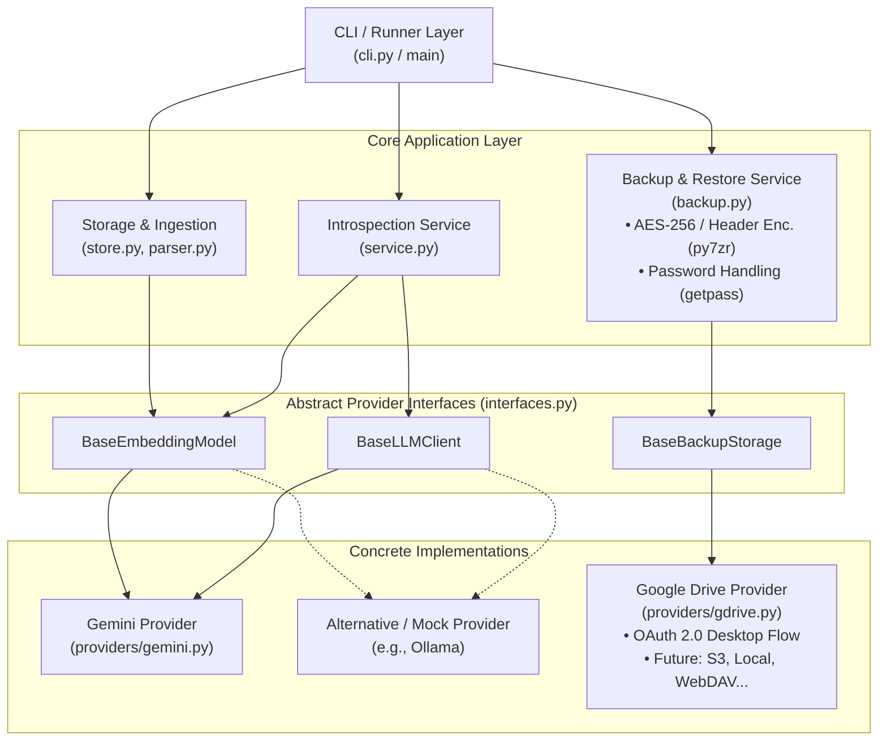

# Product Requirements Document (PRD): arc-life-diary

## 1. Overview & Problem Statement
Users maintain personal archives composed of discrete Markdown entries (`YYYY-MM-DD.md`). Entries may be multilingual or code-switched, and often non-linear (recent entries frequently embed unstructured recollections of events from years prior without explicit dates).

Standard chronological skimming and keyword matching (`grep`, BM25) fail to answer thematic, retrospective questions such as *"How have my perspectives on key challenges evolved over time?"* 

The goal of this system is to provide a single-command CLI tool that semantically retrieves relevant life events regardless of the language written, reconstructs an objective developmental progression over time, and presents direct file citations for fact-checking and auditability.

**Key Design Mandate:** The codebase must adhere to strict modularity and separation of concerns. All external AI dependencies (embeddings and LLM generation) as well as offsite storage backends (backup upload and restore download) must be decoupled behind abstract interface boundaries. Alternative AI providers (e.g., local Ollama, OpenAI, Anthropic, local ONNX) and storage backends (e.g., Google Drive, AWS S3, local/NAS directories) must be swappable without modifying database logic, ingestion code, encryption packaging, or CLI flows.

---

## 2. Goals & Non-Goals

### Goals
* **Modular Provider Interfaces:** Use Python `Protocol` or `ABC` interfaces for embedding models, text generation, and remote backup storage backends to ensure zero vendor lock-in.
* **Cross-Lingual Retrieval:** Queries must reliably retrieve relevant entries across multiple languages or mixed-language text.
* **Non-Linear Synthesis:** Differentiate between *entry creation date* (file timestamp) and *narrative memory date* (when the event actually took place) through LLM context synthesis.
* **Developmental Arc Analysis:** Produce structured, analytical reflections showing internal shift and coping mechanisms across time, rather than a flat bulleted summary.
* **Verifiable Grounding:** Every insight must link directly to the primary Markdown files with distance metrics and context snippets for auditability.
* **Low-Overhead CLI Execution:** Single-shot command-line interface with minimal runtime dependencies and local caching.
* **Zero-Knowledge Encrypted Cloud Backup & Restore:** Provide secure, client-side AES-256 encrypted archival (with fully encrypted headers via `py7zr`) and restoration targeting Google Drive via OAuth 2.0 Desktop flow, ensuring complete data privacy and open format portability (7-Zip/Keka compatible).

### Non-Goals
* **No Stateful Multi-Turn Chat:** Will not support conversational state tracking, sessions, or ongoing agent loops.
* **No Cloud Hosting / SaaS:** The vector store and operational files remain entirely local; cloud interaction is strictly limited to ephemeral inference calls and on-demand client-side encrypted backup uploads/downloads.
* **No Automated Background Daemons:** Backups and synchronizations are strictly on-demand, explicit CLI operations rather than silent background sync daemons.
* **No File Mutation During Search/Query:** The system will never write, reformat, or alter the source Markdown files (restore operations modify files only upon explicit user confirmation).
* **No Fragmented Chunking:** Entries will not be sliced into arbitrary 200-word sliding windows, preserving the full narrative integrity of each day's entry.

---

## 3. User Personas & Core Use Case

### Primary Persona
* **The Long-Term Journal Keeper:** A user who records daily notes, reflections, and past recollections in raw text, seeking to identify recurring patterns, evolving perspectives, and behavioral trends across multiple years.

### User Journeys

#### Journey A: Introspection & Thematic Querying
1. User writes an entry into their local vault (`entries/YYYY-MM-DD.md`).
2. User runs `sync` to update the local vector cache for any new or modified entries.
3. User runs a thematic query via terminal:  
   `diary "How have my perspectives on work-life balance evolved?"`
4. The system outputs:
   * A synthesized narrative tracing chronological attitude and perspective shifts.
   * A list of cited entries under `## Relevant Entries` with date, optional title, and distance scores.
5. User reads the analysis, verifies the claims against their original notes, and closes the terminal.

#### Journey B: Secure Encrypted Cloud Backup
1. User runs `diary backup` to safeguard their archive offsite.
2. CLI prompts interactively for an encryption password with confirmation (masked via `getpass`).
3. The system compresses entries into an AES-256 encrypted `.7z` archive with encrypted headers (`header_encryption=True`).
4. The system authenticates with Google Drive (prompting browser consent on first run, caching credentials in `token.json` for subsequent runs).
5. The system uploads the archive to the configured `GDRIVE_FOLDER_ID` (or root) and purges the temporary local file.

#### Journey C: Disaster Recovery & Machine Migration
1. On a new machine or following data loss, user runs `diary restore`.
2. The system authenticates with Google Drive, queries available backups, and displays a numbered list of available snapshots (or restores latest via `--latest`).
3. User selects the archive and enters the decryption password (masked).
4. The system validates the archive, prompts for confirmation before overwriting existing files, unpacks entries, and cleans up the staging archive.
5. User runs `diary sync` to rebuild their local vector index.

---

## 4. Modular System Architecture

To avoid tightly coupling the application to specific AI vendors or cloud storage backends, the system is separated into distinct layers with clear dependency boundaries:



### Module Responsibilities

1. **`interfaces.py`**: Declares abstract contracts for `BaseEmbeddingModel`, `BaseLLMClient`, and `BaseBackupStorage`. Does not import any vendor SDK.
2. **`store.py`**: Manages the local SQLite database and `sqlite-vec` virtual tables. Handles file hashing, caching, and raw KNN vector math. Completely agnostic of which embedding model produced the vectors.
3. **`parser.py`**: Reads raw `.md` files, extracts frontmatter (date/title), and cleans text payloads.
4. **`providers/gemini.py`**: Concrete implementation of `BaseEmbeddingModel` (using `gemini-embedding-001`) and `BaseLLMClient` (using `gemini-3.5-flash-lite`).
5. **`providers/gdrive.py`**: Concrete implementation of `BaseBackupStorage` using Google Drive API and OAuth 2.0 Desktop App authorization flow. Decoupled from encryption and CLI parsing.
6. **`backup.py`**: Manages archive packaging/extraction (`py7zr` with AES-256 and header encryption), interactive masked password handling, archive verification, and overwrite confirmation flows. Relies on `BaseBackupStorage` via dependency injection for remote upload and download.
7. **`service.py`**: Core orchestration. Coordinates embedding, querying SQLite, structuring prompts, and invoking the LLM. Depends solely on abstract interfaces via dependency injection.
8. **`cli.py`**: Parses terminal commands (`sync`, `query`, `search`, `backup`, `restore`), instantiates the chosen provider implementations and backup services, and prints formatted output.

---

## 5. Interface Specifications

### 5.1 Embedding Interface (`interfaces.py`)
```python
from typing import List, Protocol, runtime_checkable

@runtime_checkable
class BaseEmbeddingModel(Protocol):
    """Abstract interface for dense vector embedding generators."""
    
    @property
    def dimensions(self) -> int:
        """Vector dimensionality expected by SQLite table (e.g. 768)."""
        ...

    def embed_document(self, text: str) -> List[float]:
        """Embeds a single document for ingestion."""
        ...

    def embed_documents(self, texts: List[str]) -> List[List[float]]:
        """Embeds multiple documents in batches for efficient ingestion."""
        ...

    def embed_query(self, text: str) -> List[float]:
        """Embeds a user query string for vector search."""
        ...
```

### 5.2 LLM Synthesis Interface (`interfaces.py`)
```python
from typing import Protocol, runtime_checkable

@runtime_checkable
class BaseLLMClient(Protocol):
    """Abstract interface for text synthesis and introspection models."""
    
    def generate_synthesis(self, prompt: str, system_instruction: str) -> str:
        """Takes context and user question and returns formatted textual analysis."""
        ...
```

### 5.3 Backup Storage Interface (`interfaces.py`)
```python
from typing import List, Protocol, runtime_checkable
from dataclasses import dataclass
from datetime import datetime
from pathlib import Path

@dataclass
class RemoteBackupMetadata:
    """Metadata representing an archive stored in a remote destination."""
    file_id: str
    name: str
    created_at: datetime
    size_bytes: int

@runtime_checkable
class BaseBackupStorage(Protocol):
    """Abstract interface for remote/offsite backup storage targets."""

    def upload(self, local_path: Path, remote_filename: str) -> RemoteBackupMetadata:
        """Uploads an encrypted archive to the remote storage destination."""
        ...

    def list_backups(self) -> List[RemoteBackupMetadata]:
        """Lists available backup archives on remote storage, sorted newest first."""
        ...

    def download(self, file_id: str, destination_path: Path) -> Path:
        """Downloads a remote backup archive by ID to a local destination path."""
        ...
```

---

## 6. Functional Requirements

### FR-1: Modular Provider Swapability `[P0 - Must Have]`
* The core application logic (`service.py` and `store.py`) must never import `google.genai` directly.
* Changing providers (e.g., from Gemini to a local Ollama instance or OpenAI) must only require implementing `BaseEmbeddingModel` and `BaseLLMClient` in a new file under `providers/` and passing it to the service.

### FR-2: Entry Ingestion & Change Detection `[P0 - Must Have]`
* **Source of Truth:** Directory containing flat `.md` files named according to `YYYY-MM-DD.md`.
* **Metadata Extraction:** Parse optional YAML frontmatter (`title`, `date`). If absent, default to the filename stem.
* **Incremental Synchronization:**
  * System computes a SHA-256 hash of each file's contents.
  * Compare against stored hashes in SQLite.
  * Batches new or modified files and calls `embed_documents()` for efficient ingestion (0 redundant API calls for unchanged files).

### FR-3: Multilingual Semantic Representation & Storage `[P0 - Must Have]`
* **Embeddings:** Support cross-lingual embeddings that align concepts across multiple languages into unified vector coordinates.
* **Storage Primitives:** Store vectors locally in SQLite using `sqlite-vec` (`vec0` virtual table with cosine distance). Dimensionality dynamically adapts to `BaseEmbeddingModel.dimensions`.

### FR-4: Retrieval Pipeline & Semantic Search `[P0 - Must Have]`
* **Query Embedding:** User query is converted to a vector using `BaseEmbeddingModel.embed_query()`.
* **K-Nearest Neighbors:** Execute cosine distance search in SQLite with default limit $k = 5$.
* **Context Payload:** Fetch matching file dates, titles, full bodies, and distance metrics.
* **CLI Semantic Search:** Expose raw semantic search directly via the CLI (`diary search`) to inspect retrieved entries and similarity scores without invoking LLM synthesis.

### FR-5: Synthesis & Output Generation `[P0 - Must Have]`
* **Synthesis Engine:** Any engine implementing `BaseLLMClient`.
* **Generation Constraints:**
  * System prompt instructs the model to distinguish past memories from entry pen-dates.
  * Synthesize output coherently regardless of the source entry languages.
  * Structure output into two explicit sections:
    1. **Direct Narrative Synthesis:** Thoughtful analysis detailing shifts in coping mechanisms and mindset, generated directly without arbitrary top-level headers.
    2. **Relevant Entries:** Programmatically appended section (`## Relevant Entries`) listing retrieved entries with dates, optional titles, and cosine distance metrics.

### FR-6: Client-Side Encrypted Archival `[P0 - Must Have]`
* **Encryption Standard:** Use `py7zr` (AES-256) to package Markdown entries into an encrypted archive before upload.
* **Header Encryption:** Must explicitly enable `header_encryption=True` during archive creation to fully mask filenames, entry counts, directory layout, and metadata.
* **Universal Format Portability:** The output archive format must strictly adhere to standard 7z container specifications, remaining universally portable and openable via the project's restore command or external tools (e.g., standard 7-Zip CLI/GUI, Keka on macOS) using the user's password.
* **Archive Naming Convention:** Archive filenames must strictly conform to the pattern:
  ```text
  arc-life-diary_backup_YYYY-MM-DD_HHMMSS.7z
  ```
  where `YYYY-MM-DD_HHMMSS` represents the local timestamp at the moment of backup creation.
* **Interactive Password Handling & Zero-Persistence:**
  * Passwords must **never** be stored in `.env`, configuration files, SQLite, or disk logs.
  * Backups and restores are purely manual and on-demand; the user must be prompted interactively via standard masked CLI input (e.g., Python `getpass`).
  * **On Backup:** Require password entry with confirmation prompt (`"Enter backup encryption password: "` and `"Confirm backup encryption password: "`) to prevent upload lockouts from typos.
  * **On Restore:** Single masked password prompt (`"Enter backup decryption password: "`).

### FR-7: Modular Storage Provider & Google Drive OAuth 2.0 Integration `[P0 - Must Have]`
* **Modular Storage Protocol:** Decouple all remote storage operations behind the `BaseBackupStorage` interface (`interfaces.py`), allowing alternative storage destinations (e.g., local disk, AWS S3, Dropbox) to be swapped in without modifying core encryption or CLI workflows.
* **Google Drive Provider (`providers/gdrive.py`):** Implement `BaseBackupStorage` using the Google OAuth 2.0 Desktop Application flow (`google-auth-oauthlib`, `google-api-python-client`).
* **Interactive Consent & Token Persistence:** Trigger interactive browser consent on the initial setup run, saving session credentials locally in `token.json` for subsequent non-interactive runs. Automatically refresh expired access tokens when valid refresh tokens exist.
* **Restricted Least-Privilege Scope:** Restrict OAuth scope strictly to:
  ```text
  https://www.googleapis.com/auth/drive.file
  ```
  The application must only have access to files and folders that it has created or opened, preventing unintended access to any other user data on Google Drive.
* **Credential Security & Exclusions:** Ensure OAuth client secrets (`credentials.json`) and session tokens (`token.json`) are documented and enforced as `.gitignore` exclusions.

### FR-8: Destination Routing & Folder Resolution `[P0 - Must Have]`
* **Environment Variable Check:** Check for an optional `GDRIVE_FOLDER_ID` in `.env`.
* **Configured Target Folder:** If `GDRIVE_FOLDER_ID` is provided and non-empty, upload to that target folder ID (`parents=[GDRIVE_FOLDER_ID]`).
* **Root Fallback:** If `GDRIVE_FOLDER_ID` is missing or empty, default the upload destination to the Google Drive root directory (`parents=['root']`).
* **Routing Validation:** If `GDRIVE_FOLDER_ID` is specified but invalid or inaccessible during upload, fail fast with a descriptive error.

### FR-9: Backup & Restore Operations `[P0 - Must Have]`
* **Backup Operation (`diary backup`):**
  1. Inspect local entries directory (`entries/` or specified via `--dir`) and verify markdown entries exist.
  2. Interactively prompt user for an encryption password with confirmation (masked).
  3. Package entries into a temporary encrypted `.7z` file using AES-256 and `header_encryption=True` matching the `arc-life-diary_backup_YYYY-MM-DD_HHMMSS.7z` naming pattern.
  4. Authenticate with Google Drive (or configured `BaseBackupStorage` provider).
  5. Resolve destination folder (via `GDRIVE_FOLDER_ID` or fallback to root) and upload the archive.
  6. Clean up temporary local staging archive immediately upon upload completion or failure.
  7. Print confirmation displaying uploaded file name, remote file ID, destination folder, and upload timestamp.
* **Restore Operation (`diary restore`):**
  1. Authenticate with Google Drive via `BaseBackupStorage`.
  2. Query Google Drive for `arc-life-diary` archives (`arc-life-diary_backup_*.7z`).
  3. If no matching archives are found, notify user cleanly and exit.
  4. List available backups sorted chronologically (or default to the latest archive if `--latest` is specified).
  5. Download the selected target archive file to a temporary location.
  6. Prompt user for decryption password (masked).
  7. Inspect archive contents and prompt user for explicit confirmation before overwriting any existing local files in the target directory (`[y/N]`).
  8. Unpack entries locally into target directory and purge the temporary download file.
  9. Print restore summary and advise user to run `diary sync`.

---

## 7. Non-Functional Requirements

* **Performance & Latency:**
  * Incremental `sync` on an unchanged archive must finish in $<200\text{ ms}$.
  * Retrieval + generation end-to-end turnaround should take $<3.0\text{ seconds}$ on standard broadband.
  * Backup compression and AES-256 encryption overhead should complete in $<5.0\text{ seconds}$ for vaults containing up to 5,000 markdown entries.
* **Data Sovereignty & Zero-Knowledge Privacy:**
  * Journal files and vector embeddings reside on local disk (`diary.db`).
  * Cloud interaction is restricted to transient API calls for embedding and generation, plus user-initiated encrypted backup transfers.
  * **Zero-Knowledge Cloud Storage:** Google Drive only ever stores client-side AES-256 encrypted archives with encrypted headers; plaintext entry contents, titles, dates, counts, and encryption keys never touch the network or external servers.
  * **Credential Isolation:** OAuth client secrets (`credentials.json`), session tokens (`token.json`), and database files (`diary.db`) must never be tracked in source control.
* **Reliability & Stateless Recovery:**
  * Deleting `diary.db` and running `sync` must rebuild the entire index deterministically.
  * In the event of local drive failure, a user with access to their Google Drive account and encryption password can fully reconstruct their journal vault using `diary restore`.
* **Universal Portability & Open Formats:**
  * Backups are created in standard 7z format so that user data is never hostage to this software; users can extract archives independently using standard open-source tools (7-Zip, Keka, p7zip).
* **Loose Coupling:**
  * Codebase adheres to the Dependency Inversion Principle: High-level modules do not depend on low-level modules; both depend on abstractions.
  * Storage backends implement `BaseBackupStorage` and are completely decoupled from encryption packaging and CLI handling.

---

## 8. CLI Interface & Error Handling

### Command Specifications
```bash
# Ingests and updates index incrementally (optional --dir)
diary sync [--dir <path>]

# Executes query, prints analysis and citations
diary "<query-string>"

# Query subcommand with optional retrieval limit and custom directory
diary query "<query-string>" [--limit 5] [--dir <path>]

# Semantic search subcommand returning matching entries without LLM synthesis
diary search "<query-string>" [--limit 5] [--dir <path>]

# Encrypts and backs up entry vault to Google Drive
diary backup [--dir <path>]

# Restores entries from a Google Drive backup (interactive selection or --latest)
diary restore [--dir <path>] [--latest] [--file-id <drive-file-id>]
```

### Error Conditions
* **Provider Auth Missing:** If environment variables or credentials required by the configured provider are missing, exit gracefully with a specific error message.
* **Empty Archive:** Warn the user and exit cleanly if the entries directory contains no `.md` files during `sync`, `query`, or `backup`.
* **Dimension Mismatch:** If an existing `diary.db` was built with 768 dimensions and the user switches to a 384-dimension embedder, the database layer must raise a clear migration/rebuild warning.
* **Missing Google Drive Credentials (`credentials.json`):** If `credentials.json` is missing when executing `backup` or `restore`, exit with actionable guidance directing the user on how to create and download OAuth 2.0 Desktop credentials from the Google Cloud Console.
* **Backup Password Mismatch:** If password and confirmation inputs do not match during `diary backup`, immediately abort operation without creating local archives or uploading data.
* **Decryption Failure / Incorrect Password:** If `py7zr` encounters an incorrect password or header decryption failure during restore, abort cleanly with: `Error: Decryption failed. Incorrect password or corrupted archive.`
* **Invalid or Inaccessible `GDRIVE_FOLDER_ID`:** If the folder ID specified in `.env` cannot be resolved on Google Drive (e.g., 404 or insufficient permissions), abort with a descriptive error message indicating the target folder was not found.
* **No Remote Backups Located:** If `diary restore` queries Google Drive and finds no archives matching `arc-life-diary_backup_`, inform the user cleanly and exit without error.
* **Overwrite Confirmation Abort:** If the user declines to overwrite existing local entries during `diary restore`, cancel extraction cleanly without deleting existing local files.
* **Network & Upload Failure:** Handle network drops or API rate-limiting gracefully, cleaning up any temporary staging archives on the local disk.

---

## 9. Success Metrics & Evaluation

| Metric | Target | Verification Method |
| :--- | :--- | :--- |
| **Provider Decoupling** | Zero core edits | Switching to a new AI provider or storage backend requires adding 1 class and modifying 0 lines of database/ingestion/backup code. |
| **Cross-Lingual Recall** | 100% | Queries in one language retrieve relevant entries written in different or mixed languages in the top 3 results. |
| **Temporal Disentanglement** | > 85% accuracy | Model correctly identifies an event as occurring in the past when recounted inside a newer file. |
| **API Call Efficiency** | Zero redundant calls | Consecutive `sync` runs without file modifications make 0 external embedding calls. |
| **Zero-Knowledge Privacy** | 100% encrypted metadata & payload | 100% of uploaded archives use AES-256 with `header_encryption=True`; inspection with binary/hex tools reveals zero plaintext file names or diary contents. |
| **Universal Restore Portability** | 100% compatibility | Backups produced by `diary backup` can be unpacked successfully by external CLI/GUI tools (`7z x`, Keka) with the user password. |
| **Password Hygiene** | 0 disk writes | Passwords never written to `.env`, SQLite, logs, or command-line arguments. |
| **Credential Safety** | 0 leaks in git | `credentials.json` and `token.json` strictly excluded via `.gitignore`; validated by automated pre-commit / CI checks. |